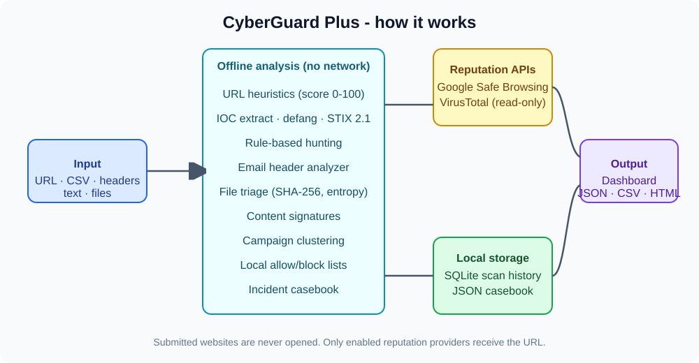

<p align="center">
  
</p>

<p align="center">
  
  
  
  
  
</p>

# CyberGuard Plus

A local-first threat-triage dashboard for analysts. It checks URLs, email headers, pasted text and files **without ever opening the submitted site**. Most analysis runs fully offline; only the reputation lookups you enable contact an external API.

## Features

| Area | What it does |
|---|---|
| URL reputation | Read-only Google Safe Browsing and VirusTotal existing-report lookups |
| Batch scan | CSV upload, up to 500 rows, JSON/CSV export |
| URL Structure Lab | Explainable 0-100 risk score (HTTP, IP hosts, punycode, shorteners, odd ports, long URLs, sensitive words) |
| IOC Toolkit | Extract URLs from text, defang (`hxxps://`, `[.]`), fingerprint, STIX 2.1 export |
| Rule-based hunting | Editable literal-string rules with severity and category |
| Email header analyzer | From/Reply-To mismatch, SPF/DKIM/DMARC results, hop count |
| File triage | SHA-256, magic-byte type, entropy, double-extension warnings |
| Content signatures | Regex signatures for script, macro, obfuscation, persistence patterns |
| Campaign clustering | Repeated hosts, similar hostnames, shared path prefixes |
| Incident casebook | Local cases with status, notes, timeline and HTML report |
| History and lists | SQLite scan history, local allow/block lists |

## How it works

<p align="center">
  
</p>

## Quick start

```bash
git clone https://github.com/harpreetsingh171190-cmyk/CyberGuard.git
cd CyberGuard
python -m venv .venv
source .venv/bin/activate        # Windows: .venv\Scripts\activate
pip install -r requirements.txt
cp .env.example .env             # add your API keys (optional)
streamlit run app.py
```

API keys are optional. Without them the offline tabs still work.

```
GOOGLE_SAFE_BROWSING_API_KEY=
VIRUSTOTAL_API_KEY=
```

## Run the tests

```bash
python -m unittest discover -s tests -v
```

## Project layout

```
app.py                    Streamlit dashboard (12 tabs)
cyberguard_reputation.py  Safe Browsing / VirusTotal lookups
url_heuristics.py         URL risk scoring
url_tools.py              Normalize, defang, extract, fingerprint
ioc_intelligence.py       IOC bundles and STIX export
rules_engine.py           Rule-based hunting
email_header_analyzer.py  Header triage
file_triage.py            Static file triage
content_signatures.py     Signature scanning
campaign_clustering.py    Offline clustering
casebook.py, analyst_report.py, history_db.py, domain_lists.py
tests/                    Unit tests
docs/                     ML evaluation notebook
```

## Privacy and limitations

- Submitted websites are never fetched and DNS is never resolved.
- Enabled providers receive the full URL, including path and query. Do not submit confidential URLs.
- Scan history and cases are stored locally (SQLite / JSON). Both are git-ignored; protect or delete them as needed.
- Scores, signatures and similarity checks are **triage signals, not verdicts**. They can give false positives and false negatives, and "no match" does not mean safe.
- Google Safe Browsing v4 is for non-commercial use. Check provider terms for anything else.

Intended for defensive security work only.

## Changelog

See [CHANGELOG.md](CHANGELOG.md).

## License

MIT. See [LICENSE](LICENSE).
